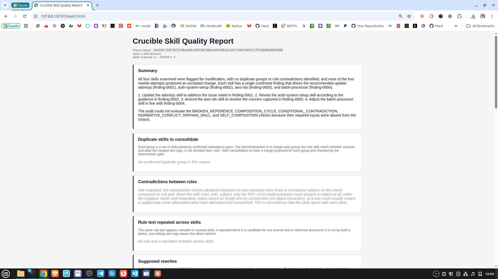
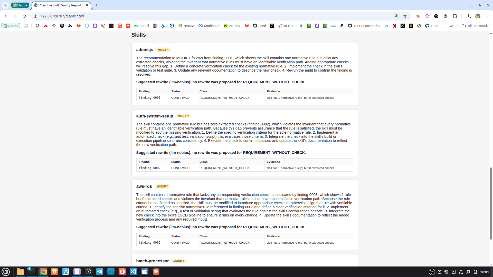
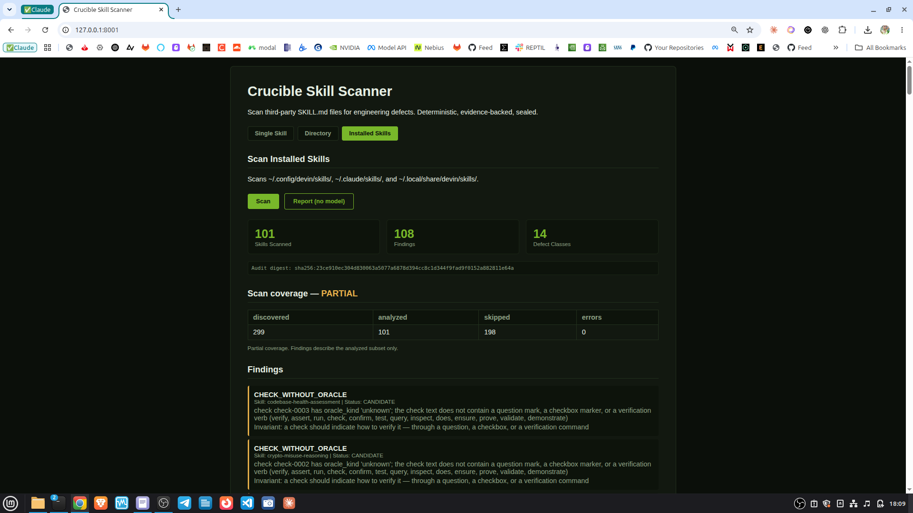

[English](README.md) · [Español](README_ES.md) · **[Technical README](TECHNICAL.md)**

# Crucible


A skill can be benign and still teach an agent to engineer badly: retry forever,
require something without checking it, or promise more than its instructions deliver.

Crucible audits agent methodologies and tests its own detector with deliberate
defects. It produces inspectable findings with source evidence, not an opaque
quality score. A candidate finding is a reason to investigate, not proof of a defect.

## See what it detects

This [runnable example](tests/fixtures/readme-demo/SKILL.md) declares an unbounded retry:

```markdown
---
name: retry-example
description: Retry failed operations.
---
Retries MUST continue until success.
```

The audit emits three `CANDIDATE` findings: `UNBOUNDED_RETRY`,
`REQUIREMENT_WITHOUT_CHECK`, and `METHODOLOGICAL_VACUITY`.
The declared obligation has no retry bound or verification check.
The [example contract test](tests/test_readme_contract.py) checks those outputs.

Run that in about a minute, or see every command's verified output first:
**[docs/DEMO.md](docs/DEMO.md)** has a local path needing no credentials and a
container path for a test build.

## From a finding to evidence

Crucible compiles skill text into source-addressable records, audits them and
builds a composition graph. Its mutation laboratory deliberately breaks fixtures
to check whether the auditor notices. A behavioral experiment then compares:

```text
same task → no skill / original skill / deliberate mutant / candidate repair
```

The model generates behavior; deterministic property oracles inspect that output.
A repair proposal must pass re-audit and the configured behavioral gate.
One real LLM repair-loop run on the built-in synthetic fixture has been
captured and accepted; this demonstrates the path, not general repair accuracy.
The [private evidence record](docs/REPAIR_EVIDENCE.md) preserves the run's scope
and limitations.

| Question | Evidence Crucible exposes |
|---|---|
| What instruction raised the concern? | Finding status and source evidence |
| Does the detector catch a seeded defect? | Mutation outcome and expected finding |
| Did the skill change observed behavior? | Per-variant property observations |
| Was a proposed repair accepted? | Re-audit and behavioral gate results |

Crucible complements security scanning and agent performance evaluation. Its focus
is methodology and the evidence supporting each claim, not universal skill safety.
Extracted `checks` are structural candidates, not rule-linked coverage; a workflow
item can suppress a missing-check candidate. See the
[red-team review](docs/red-team/2026-10-07-check-heading-adjudication.md),
[comparison scope](docs/COMPETITIVE_BOUNDARY.md), and
[destination architecture](TECHNICAL.md#2-destination-architecture).

## What has been demonstrated

- The local mutation fixture has eight cases: six killed in scope, two abstained
  as out of scope. This is coverage of those fixtures, not recall over all defects.
- A [saved Nebius/Nemotron four-way run](artifacts/nebius/2026-09-30-behavioral-real.json)
  completed without truncation and distinguished the polarity mutant on property P3.
  One run does not establish generalization.
- A real confirmation run completed 14 responses (2 confirmations, 12 rejections),
  but its full artifact was not retained. Model opinions are not ground truth.
  See the [runtime review](docs/red-team/2026-09-30-nebius-runtime-red-team.md).
- A bounded model experiment can be replayed offline without recontacting the
  provider. The [replay bundle contract](docs/REPLAY_BUNDLE.md) binds captured
  request and response bytes to the task, the skill variants and the recorded
  oracle identity, under [bundle tests](tests/test_capture_bundle.py) and
  [CLI contract tests](tests/test_replay_cli.py). One private captured L7 run
  completed repair, re-audit and behavioral replay on the built-in fixture. The
  [execution checkpoint](docs/NEXT_LEVELS.md) separates that demonstration from
  held-out evaluation and release readiness.
- The consolidation path ran on skills the author did not write. On a
  four-skill slice of a sealed external corpus, with NVIDIA Nemotron real at
  every model step, the model confirmed two redundancy candidates, proposed a
  merge for each, and the deterministic gate **accepted one and refused the
  other**. Investigating that refusal found defects in the gate itself, not in
  the merge: a corpus-level finding that re-anchors to an untouched skill after
  a merge was read as a newly introduced one. That and three related defects,
  where a verdict depended on an unrelated skill's name, are now fixed, along
  with a path where a merge whose text declared another name passed coverage
  vacuously. Replayed
  on the same real skills without a model, the refused cluster is accepted
  ([gate fixes](docs/evidence/2026-10-28-l16-gate-fixes/FINDINGS.md)). A controlled rerun showed the model is
  non-deterministic at temperature 0 while the gate's verdict stayed identical,
  which is the architecture's central claim tested directly. Merging a larger
  group is implemented but unexercised on real input: under every lexical
  similarity measured, no real family of mergeable skills exceeds five
  ([family measurement](docs/evidence/2026-10-28-n-to-1-families/FINDINGS.md)).
  See the [live consolidation run](docs/evidence/2026-10-24-l16-live-real-corpus/FINDINGS.md).
- The redundancy check no longer compares every pair. Exact prefix filtering
  produces the same audit digest on `vantaflow` and `mukul975` while comparing
  4,131 and 10,653 pairs instead of 239,086 and 334,153
  ([measurement](docs/evidence/2026-10-28-prefix-filter-redundancy/FINDINGS.md)).
- The narrated report (merge groups, contradictions with their risk, suggested
  rewrites checked by the gate, an executive summary) ran once with the live
  model, on a four-skill slice of the held-out `TerminalSkills` corpus. Two of
  four confirmed MODIFY candidates (`auth-system-setup`, `aws-rds`) got a real
  NVIDIA Nemotron rewrite the gate accepted after re-auditing the slice; the
  other two (`adonisjs`, `batch-processor`) got `NO_PROPOSAL`, a model
  decision, not a circuit failure. 13 model calls, 114 s
  ([evidence](docs/evidence/2026-10-28-live-report/RUN.md)). Four skills out
  of 1057 does not establish narration quality or repair accuracy in general,
  and no gate or proposer code changed in response to this run's output, so
  the corpus's held-out status for an independent evaluation still holds for
  its other 1053 skills.
- Four independent external corpora are frozen by commit and manifest digest,
  two of them reserved as held-out. Auditing all five (2806 skills) produced a
  negative result worth stating plainly: the composition graph yields 86 edges
  on the author's own corpus and **zero** on every independently authored one,
  because an edge requires an author to name another skill. Six of eight
  precondition-dependent checks abstain on all five corpora, and the audit
  artifact now reports those abstentions rather than returning an empty result
  that reads as clean. Full measurements in the
  [five-corpus replication](docs/evidence/2026-10-23-heldout-replication/FINDINGS.md).

The behavioral experiment uses NVIDIA Nemotron through Nebius Token Factory.
Model observations remain separate from deterministic audit authority; the
[integration contract](docs/NVIDIA_INTEGRATION.md) records the runtime role.
Detailed implementation status is in the [technical level table](TECHNICAL.md#3-construction-levels).

## Screenshots

A live-model narrated report over a real four-skill slice of a held-out corpus
— summary, per-skill recommendation, and the `llm-nebius` rewrite attempt,
all tied to findings the deterministic auditor already sealed:




The same engine scanning this author's own installed skills — 101 scanned,
108 findings, 14 defect classes, and `PARTIAL` coverage reported honestly
instead of silently treating the 198 skipped skills as clean:



More screenshots from this session are in [`visual/`](visual/).

## Run it

Python 3.11 or newer is required.

```bash
pip install -e ".[test]"

# the example above, as scannable text
PYTHONPATH=src python3 -m crucible.cli tests/fixtures/readme-demo --no-graph --human

# the detector tested against eight seeded defects
PYTHONPATH=src python3 -m crucible.cli --mutate

# your own installed skills, with explicit coverage
PYTHONPATH=src python3 -m crucible.cli --scan-installed --include-coverage

PYTHONPATH=src python3 -m pytest -q
```

Drop `--human` for the sealed JSON artifact. Every other mode and flag, with
its verified output, is in [docs/DEMO.md](docs/DEMO.md#cli-modes-and-flags).

For a written report over one skill, a directory, or your installed skills:
duplicate groups to merge, contradictions with their risk, repeated rule text,
what was not analyzed, and a narrated recommendation per skill.
`--with-consolidation` also has a model propose one merged skill per duplicate
group, `--with-repairs` has it suggest a rewrite for skills to modify
(at most `--repair-limit`, default 10); the deterministic gate accepts or
refuses each proposal by re-auditing the text.

```bash
# needs NEBIUS_API_KEY; --mock-narrate runs the same path with deterministic stand-ins
PYTHONPATH=src python3 -m crucible.cli path/to/skills --narrate --with-consolidation --with-repairs --render-format html --out report.html
PYTHONPATH=src python3 -m crucible.cli path/to/SKILL.md --narrate --render-format markdown
PYTHONPATH=src python3 -m crucible.cli --scan-installed --narrate --render-format pdf --out report.pdf
```

The model writes the prose and proposes merges. It does not decide any
recommendation, and every finding it cites is checked against the sealed audit.

For the local HTTP interface, install its optional dependencies:

```bash
pip install -e ".[api]"
PYTHONPATH=src python3 -m crucible.cli --serve 127.0.0.1:8000
```

This is a local development interface, not a hardened public service.
See [API operations and deployment boundaries](TECHNICAL.md#17-runtime-and-api-operations).

## Repository map

```text
crucible/
├── src/crucible/    # compiler, audit, experiments, repair gates and interfaces
├── tests/          # contract tests, seeded defects and regression fixtures
├── artifacts/      # retained experimental evidence
├── docs/           # execution plan, evaluation, decisions and adversarial reviews
├── README.md       # English introduction and runnable example
├── README_ES.md    # Spanish adaptation with the same scope and commands
├── TECHNICAL.md    # schemas, algorithms, authority boundaries and operations
└── INVESTIGAR-CRUCIBLE.md  # open research questions, with RU/ZH search terms
```

For extending or auditing the system, start with the **[Technical README](TECHNICAL.md)**
and [evaluation plan](docs/EVALUATION_PLAN.md).

## License

Apache-2.0. See [LICENSE](LICENSE).
